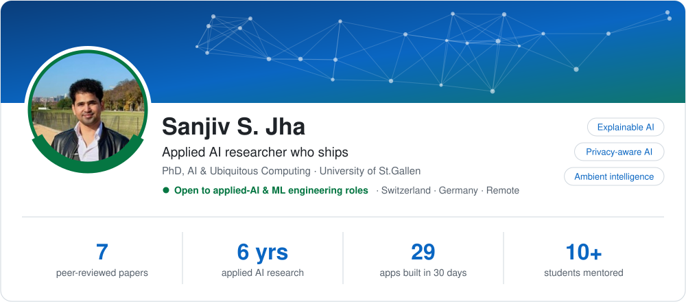
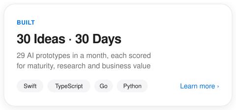
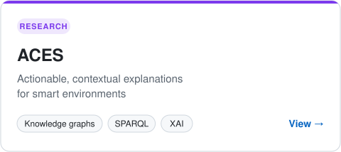
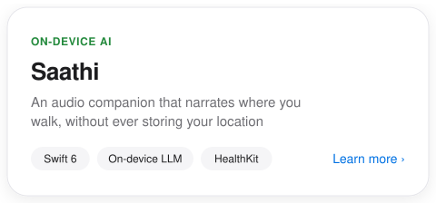
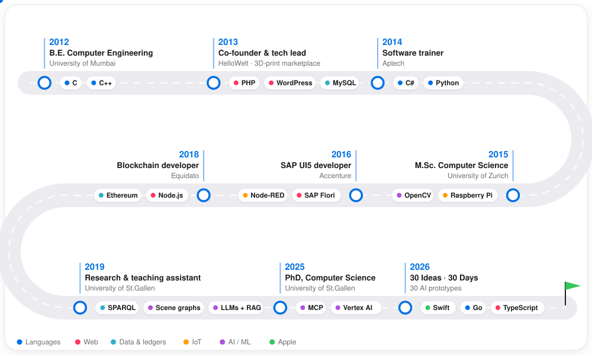
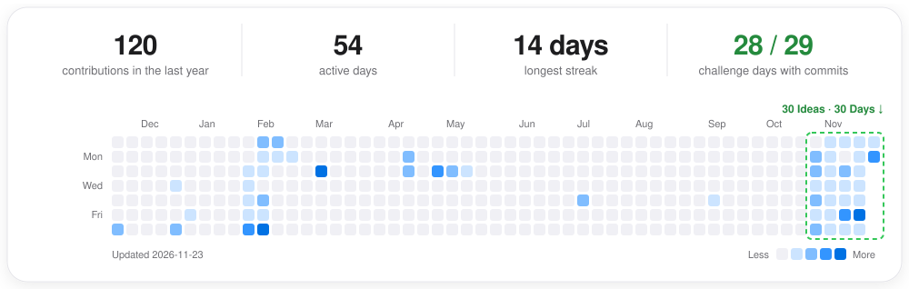

<!-- Generated by build.py — edit the content there, then run: python3 build.py -->

<picture><source media="(prefers-color-scheme: dark)" srcset="assets/header-dark.svg"></picture>

I turn AI research into working systems: explainable, privacy-aware assistants that understand the places and people around them. 
PhD on transparent, privacy-preserving intelligent systems · 7 peer-reviewed papers · building one prototype a day.

<a href="https://www.linkedin.com/in/snjivza/"><b>LinkedIn</b></a> &nbsp;·&nbsp;
<a href="https://scholar.google.com/citations?user=tHPrrWoAAAAJ"><b>Google Scholar</b></a> &nbsp;·&nbsp;
<a href="https://jhasanjiv5.github.io"><b>Website &amp; CV</b></a> &nbsp;·&nbsp;
<a href="https://github.com/jhasanjiv5/30_day_30_ideas"><b>30-day lab</b></a>

---

### What are you here for?

<b>💼 I'm hiring:</b> what can you do for my team?

- **Take AI from paper to product.** Six years of applied AI research, and a month of turning ideas into working apps (Swift, TypeScript, Go, Python).
- **Build trustworthy AI.** Explanations users can act on, on-device and local models, and guardrails such as [Kavach](https://github.com/jhasanjiv5/30_day_30_ideas/tree/main/kavach).
- **Work end to end.** Sensors and IoT pipelines, LLM/RAG back ends, web and native front ends, Docker and GCP.
- **Lead and teach.** Mentored 10+ students; co-founded a start-up; programme committees at IEEE ICTAI 2025, Mensch und Computer 2024 and IoT 2021.

Open to applied-AI & ML engineering roles · Switzerland · Germany · Remote · full CV on my [website](https://jhasanjiv5.github.io).

<b>🔬 I'm a researcher:</b> what do you work on?

| Year | Work | In one line |
| :---: | :--- | :--- |
| 2024 | **Proactive multimodal question answering** | Combines video, audio, activity and sensor data; 12% more accurate zero-shot QA with LLMs than recent benchmarks. |
| 2023 | **Scene understanding over time** | Tracks objects and their relationships as a scene changes, using scene graphs. |
| 2022 | **Actionable explanations (ACES)** | Counterfactual explanations for smart environments from sensors and semantic knowledge graphs. |

Themes: explainable AI, ubiquitous and ambient computing, multimodal LLMs, privacy by design. Full list on [Google Scholar](https://scholar.google.com/citations?user=tHPrrWoAAAAJ).

<b>👀 Just show me something cool</b>

- 🎧 [Saathi](https://github.com/jhasanjiv5/30_day_30_ideas/tree/main/Saathi): an audio companion that tells you about the place you're walking through.
- 🎬 [Drishya](https://github.com/jhasanjiv5/30_day_30_ideas/tree/main/drishya): research papers turned into narrated, cited video podcasts.
- 🛡️ [Kavach](https://github.com/jhasanjiv5/30_day_30_ideas/tree/main/kavach): a local security guard for AI coding agents.
- 🧪 [The whole lab notebook](https://github.com/jhasanjiv5/30_day_30_ideas): 29 apps, scored and charted.

---

### Featured work

<table>
<tr>
<td width="50%"><a href="https://github.com/jhasanjiv5/30_day_30_ideas"><picture><source media="(prefers-color-scheme: dark)" srcset="assets/lab-dark.svg"></picture></a></td>
<td width="50%"><a href="https://github.com/jhasanjiv5/ContexualExplainerSystem"><picture><source media="(prefers-color-scheme: dark)" srcset="assets/aces-dark.svg"></picture></a></td>
</tr>
<tr>
<td width="50%"><a href="https://github.com/jhasanjiv5/30_day_30_ideas/tree/main/kavach"><picture><source media="(prefers-color-scheme: dark)" srcset="assets/kavach-dark.svg"></picture></a></td>
<td width="50%"><a href="https://github.com/jhasanjiv5/30_day_30_ideas/tree/main/drishya"><picture><source media="(prefers-color-scheme: dark)" srcset="assets/drishya-dark.svg"></picture></a></td>
</tr>
<tr>
<td width="50%"><a href="https://github.com/jhasanjiv5/30_day_30_ideas/tree/main/Saathi"><picture><source media="(prefers-color-scheme: dark)" srcset="assets/saathi-dark.svg"></picture></a></td>
<td width="50%"><a href="https://github.com/jhasanjiv5/ComplianceCopilot"><picture><source media="(prefers-color-scheme: dark)" srcset="assets/compliance-dark.svg"></picture></a></td>
</tr>
</table>

### The road so far

<picture><source media="(prefers-color-scheme: dark)" srcset="assets/journey-dark.svg"></picture>

From Mumbai to St.Gallen, from embedded C to explainable AI: the tools on the road are what each stretch was built with.

### Activity

<picture><source media="(prefers-color-scheme: dark)" srcset="assets/activity-dark.svg"></picture>

### Toolbox

<picture><source media="(prefers-color-scheme: dark)" srcset="assets/toolbox-dark.svg"></picture>

English · German · Hindi

